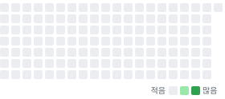

# TodayToDo

[](https://github.com/Jirunu/TodayToDo/actions/workflows/daily.yml)
[](https://github.com/Jirunu/TodayToDo/actions/workflows/test.yml)
[](https://jirunu.github.io/TodayToDo/)


🌐 **https://jirunu.github.io/TodayToDo/** · ▲ **https://today-to-do-phi.vercel.app**

매일 기술 뉴스에서 공부할 CS 개념을 뽑고, 그 개념과 이어지는 백준 문제를 추천받아 **1일 1CS · 1일 1솔 · 1일 1커밋**을 하는 저장소입니다.

```
③ News   GeekNews · Hacker News에서 오늘의 기술 뉴스 수집, 관심 분야 키워드로 정렬
   ↓
① CS     오늘의 커리큘럼 개념(내장 60개) + 뉴스에서 뽑은 개념·퀴즈 (Claude API, 키가 있을 때)
   ↓
② Coding 개념과 이어지는 solved.ac 태그 → 내 수준의 안 푼 문제
   ↓
④ Commit 내가 쓴 요약(notes/)과 풀이(solutions/)를 커밋 → 잔디
```

## 오늘

<!-- TODAY:START -->
**오늘 (2026-11-29)** → [daily/2026-11-29.md](daily/2026-11-29.md) · [개념 아카이브](concepts.md) · [주간 리포트](weekly/)

- [BOJ 1654 랜선 자르기](https://www.acmicpc.net/problem/1654) Silver II `#binary_search` (오늘 개념과 연결)

🔥 연속 0일 · 📝 누적 노트 0개



<!-- TODAY:END -->

## 매일 하는 일

1. 07:00 KST에 GitHub Actions가 오늘의 기록을 만들고 웹 페이지와 이 README를 갱신합니다.
2. 오늘의 CS를 공부하고 `notes/날짜.md`에 요약합니다. ([템플릿](notes/TEMPLATE.md)) 웹 페이지의 **노트 쓰기** 버튼을 누르면 GitHub에서 바로 만들 수 있습니다.
3. 오늘의 문제를 풀고 `solutions/BOJ_번호.확장자`로 커밋합니다. 웹 페이지의 **풀이 올리기** 버튼도 같은 곳으로 연결됩니다.

자동 커밋은 봇 계정이라 잔디에 잡히지 않습니다. 잔디는 내가 직접 한 공부 커밋으로만 채워집니다.
로컬에서 커밋하기 전에 `git pull`로 봇이 만든 파일을 먼저 받아 오세요.

## 웹 페이지

| 메뉴 | 내용 |
|---|---|
| 오늘 | 통계(연속 기록·노트·푼 문제·개념 수), 공부 잔디, 오늘의 CS·퀴즈·문제·뉴스, 내 노트. 이전/다음 날 이동 |
| 기록 | 월별 기록 목록, 노트·풀이 여부 표시, 개념 이름으로 검색 |
| 개념 | 공부한 개념 전체를 과목별로 필터·검색, 개념 연결 그래프 |
| 주간 | 주차별 리포트 |

라이트·다크 모드와 모바일 화면을 지원합니다.

## 자동으로 쌓이는 것

| 기능 | 내용 |
|---|---|
| 문제 추천 | 오늘 개념과 이어지는 태그 → 없으면 solved.ac 기준 내가 가장 적게 푼 태그 |
| 관심 키워드 확장 | 뉴스에 반복해서 나온 용어를 다음 날 관심 키워드에 추가, 7일간 안 나오면 제외 (`data/keywords.json`) |
| 확인 퀴즈 | 오늘 개념으로 단답·O/X 3문제 |
| 중복 방지 | 최근 30일 동안 공부한 개념은 뉴스 개념으로 다시 고르지 않음 |
| 복습 | 1일, 7일, 30일 전에 공부한 개념을 오늘 페이지에 다시 표시 |
| 개념 아카이브 | 지금까지 나온 개념 전체와 개념 연결 그래프 ([concepts.md](concepts.md)) |
| 주간 리포트 | 월요일 아침에 지난주 노트·풀이·키워드·LLM 토큰 사용량 정리 (`weekly/`) |
| 디스코드 알림 | `DISCORD_WEBHOOK_URL` Secret이 있으면 아침마다 요약과 웹 페이지 링크 전송 |

## 설정

| 항목 | 위치 |
|---|---|
| 관심 분야와 키워드 | `config.json`의 `field` (`backend`, `ai`, `security`, `frontend`)와 `fields` |
| solved.ac 아이디, 난이도 | `config.json`의 `solvedac_handle`, `tier` |
| CS 커리큘럼 | `curriculum.json` (개념마다 핵심 3줄, 면접 질문, 퀴즈, 연결 태그) |
| API 키 (선택) | 저장소 Settings → Secrets: `ANTHROPIC_API_KEY`. 없으면 **기본 모드**로 내장 커리큘럼·관심 분야 뉴스·문제 추천만 하고, 있으면 그날 뉴스에서 뽑은 개념과 퀴즈가 더해집니다 |
| 디스코드 알림 (선택) | Secrets: `DISCORD_WEBHOOK_URL` |
| 웹 페이지 (GitHub Pages) | Settings → Pages → Source `Deploy from a branch`, Branch `main` / `(root)` |
| 웹 페이지 (Vercel) | [vercel.com/new](https://vercel.com/new)에서 이 저장소를 Import → Framework `Other` 그대로 Deploy. 설정은 `vercel.json`에 있고, 봇이 매일 커밋하면 자동으로 다시 배포됩니다 |

## 개발

```bash
python test_todaytodo.py   # 외부 호출 없이 도는 자가 점검 (push 때 Actions에서도 자동 실행)
```

| 파일 | 역할 |
|---|---|
| `todaytodo.py` | 매일 실행되는 스크립트: 뉴스 수집 → 개념·퀴즈 생성 → 문제 추천 → 파일 생성 |
| `index.html` | github.io 웹 페이지 (빌드 없이 `data/*.json`을 읽어 그림) |
| `config.json` | 관심 분야, solved.ac 설정 |
| `curriculum.json` | 매일 하나씩 도는 CS 커리큘럼 60개 |
| `.github/workflows/daily.yml` | 매일 07:00 KST 실행 |
| `.github/workflows/test.yml` | 코드가 바뀔 때 자가 점검 |

## 데이터 원칙

- 뉴스는 [GeekNews](https://news.hada.io) 공개 RSS(robots.txt에서 AI 입력 허용)와 [Hacker News 공식 API](https://github.com/HackerNews/API)만 사용합니다.
- 기사 본문은 저장하지 않고 제목, 짧은 요약, 링크만 사용합니다.
- 문제 추천은 solved.ac API, 개념 정리는 Claude API를 사용합니다.
