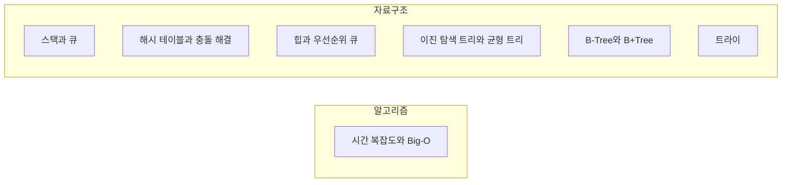

# 개념 아카이브

지금까지 공부한 개념 7개 (×N은 다시 나온 횟수)

## 개념 연결 그래프

## 전체 목록

| 날짜 | 개념 | 과목 |
|---|---|---|
| [2026-11-27](daily/2026-11-27.md) | 시간 복잡도와 Big-O | 알고리즘 |
| [2026-11-26](daily/2026-11-26.md) | 트라이 | 자료구조 |
| [2026-11-25](daily/2026-11-25.md) | B-Tree와 B+Tree | 자료구조 |
| [2026-11-24](daily/2026-11-24.md) | 이진 탐색 트리와 균형 트리 | 자료구조 |
| [2026-11-23](daily/2026-11-23.md) | 힙과 우선순위 큐 | 자료구조 |
| [2026-11-22](daily/2026-11-22.md) | 해시 테이블과 충돌 해결 | 자료구조 |
| [2026-11-21](daily/2026-11-21.md) | 스택과 큐 | 자료구조 |
