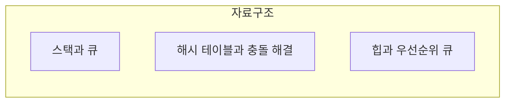

# 개념 아카이브

지금까지 공부한 개념 3개 (×N은 다시 나온 횟수)

## 개념 연결 그래프

## 전체 목록

| 날짜 | 개념 | 과목 |
|---|---|---|
| [2026-11-23](daily/2026-11-23.md) | 힙과 우선순위 큐 | 자료구조 |
| [2026-11-22](daily/2026-11-22.md) | 해시 테이블과 충돌 해결 | 자료구조 |
| [2026-11-21](daily/2026-11-21.md) | 스택과 큐 | 자료구조 |
